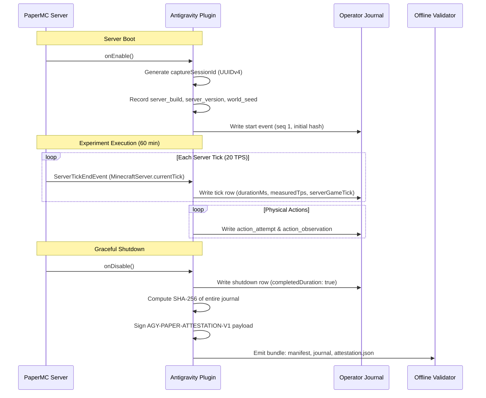

# Paper Server Evidence Capture and Cryptographic Provenance Architecture

**Document Version:** 1.0.0  
**Status:** Approved Design Document (Mission 007)  
**Author:** Google Antigravity Evidence Verification Team  
**Scope:** Architecture and Cryptographic Specification for PaperMC Minecraft Server Capture

---

## 1. Executive Summary

To establish genuine live-run authenticity for AI Civilization experiments, the evidence validator requires cryptographic proof directly from the Minecraft runtime. Without server-side cryptographic provenance, an offline evaluator cannot mathematically distinguish authentic server execution from simulated clock fixtures or caller-constructed synthetic journals.

This document specifies the server capture contract, signing architecture, lifecycle management, and strict trust boundary limitations for the PaperMC server capture system.

---

## 2. Cryptographic Attestation Specification

### 2.1 Algorithm and Canonical Payload

All Paper-side attestations use **Ed25519** (Edwards-curve Digital Signature Algorithm, RFC 8032) asymmetric keypairs. 

The attestation signature covers a deterministic canonical payload format (`AGY-PAPER-ATTESTATION-V1`):

```text
AGY-PAPER-ATTESTATION-V1
experiment_id:<UUID or string>
capture_session_id:<UUIDv4>
server_version:<Paper version, e.g. 1.21.6>
server_build:<Paper build number, integer>
source_sha:<Git commit SHA of experiment codebase>
evidence_digest:<SHA-256 hex of complete raw journal lines joined by \n>
started_at:<ISO 8601 UTC timestamp>
ended_at:<ISO 8601 UTC timestamp>
first_server_tick:<Integer, start game tick>
last_server_tick:<Integer, end game tick>
total_server_ticks:<Integer, elapsed game ticks>
```

Field ordering is strictly fixed with newline (`\n`, `0x0A`) delimiters. Trailing whitespace or carriage returns (`\r`) are rejected.

### 2.2 Dual-Layer Cryptographic Binding

The capture system implements two orthogonal tamper-detection layers:

1. **Intra-stream Hash Chain:** Every individual journal row $i$ contains:
   $$\text{hash}_i = \text{SHA256}(\text{hash}_{i-1} \parallel \text{canonical\_json}(R_i))$$
   Any row insertion, row deletion, or in-place value modification breaks all subsequent hashes in the chain.

2. **Stream-level Asymmetric Attestation:** At capture session termination, the server computes the SHA-256 digest of the entire raw journal file and asymmetrically signs the `AGY-PAPER-ATTESTATION-V1` payload:
   $$\sigma = \text{Sign}_{\text{privKey}}(\text{Payload}(\text{evidence\_digest}, \text{session\_id}, \dots))$$
   Because the signature requires the private key (isolated to the server host/enclave), an attacker who tampers with the journal cannot recalculate the hash chain without invalidating the server's digital signature.

---

## 3. Key Placement and Protection

### 3.1 Principle of Least Privilege

- **No Repository Key Storage:** Signing private keys must **never** be committed to source control or included in repository fixtures. Only synthetic temporary test keys generated in memory are permitted in offline tests.
- **Dedicated Capture Authority:** The private key represents an authorized capture agent (e.g., `paper-prod-signing-authority-v1`) whose corresponding public key is registered in the validator's operator trust root.

### 3.2 Key Storage Architectures

| Deployment Tier | Recommended Key Storage | Key Extraction Risk |
| :--- | :--- | :--- |
| **Tier 1: Cloud Production** | Cloud KMS / HSM (Google Cloud KMS, AWS CloudHSM) | Negligible (Key never leaves hardware) |
| **Tier 2: Bare-Metal Cluster** | PKCS#11 Hardware Security Module or TPM 2.0 | Negligible (Hardware-bound) |
| **Tier 3: Dedicated VM/Host** | Environment-injected secret with Linux filesystem permissions `0400` owned by `minecraft:minecraft` | Low (Requires host root compromise) |
| **Tier 4: Offline Testing** | Ephemeral in-memory keypair (`createTestAttestationKeypair`) | Isolated to test process |

---

## 4. Capture Session Lifecycle



### 4.1 Session Initialization
1. When PaperMC initializes the capture plugin, a cryptographically secure random UUIDv4 is generated for `captureSessionId`.
2. The initial `start` row is written to the journal with `seq: 1`, `previousHash: "0000000000000000000000000000000000000000000000000000000000000000"`.
3. The server environment attributes (`serverBuild`, `version`, `worldSeed`, `sourceSha`) are bound into the plugin context.

### 4.2 Tick Capture Contract
1. On each tick (or batched tick sample, e.g., every 100 ticks / 5 seconds), the plugin queries `MinecraftServer.getServer().getTickCount()`.
2. The plugin appends a `tick` event containing:
   - `durationMs`: Wall time elapsed during interval.
   - `measuredTps`: Rolling average TPS from Paper's tick metrics.
   - `serverGameTick`: Monotonically increasing absolute engine tick count.
3. If tick count regresses or jumps unexpectedly without corresponding wall time, an internal warning flag is set.

### 4.3 Graceful Termination and Signing
1. When the experiment completes, the plugin flushes all pending journal rows.
2. A `shutdown` row is appended (`completedDuration: true`, `mode: "live"`).
3. The journal file is closed and hashed with SHA-256.
4. The attestation payload is assembled and signed with the Ed25519 private key.
5. `attestation.json` is exported alongside the journal.

---

## 5. Threat Model and Tamper Defenses

| Adversarial Attack | Detection Mechanism | Validator Outcome |
| :--- | :--- | :--- |
| **Row Insertion / Deletion / In-Place Edit** | SHA-256 hash chain break; evidence digest mismatch against signed attestation | `VIOLATIONS_DETECTED` (CORRUPTED_HASH_CHAIN) |
| **Fabricated Live Run from Offline Simulator** | Attestation missing, forged signature, or wrong public key | `NOT_PROVEN` (UNPROVEN_PAPER_AUTHENTICITY) |
| **Fast-Forward Wall Clock (58.8 min claiming 60 min)** | Wall-clock timestamp delta $< 3,600,000\text{ ms}$ | `VIOLATIONS_DETECTED` (DURATION_EVIDENCE_DEFICIT) |
| **Spliced / Replayed Capture from Another Run** | `experimentId` or `captureSessionId` mismatch against manifest | `NOT_PROVEN` / `VIOLATIONS_DETECTED` |
| **Server Crash / Unrecorded Pause** | Timestamp gap $> 60\text{ s}$ or serverGameTick regression | `VIOLATIONS_DETECTED` (DURATION_EVIDENCE_DEFICIT) |
| **Untrusted Third-Party Attestation** | Signing authority not present in operator `trustedKeys` | `NOT_PROVEN` (Untrusted signing authority) |

---

## 6. The Fundamental Trust Boundary Limitation

> [!IMPORTANT]
> **What the Evidence Validator Proves:**
> The validator cryptographically guarantees that the evidence stream matches byte-for-byte what a designated PaperMC server process observed and signed.

> [!WARNING]
> **What the Evidence Validator Cannot Prove (Without Remote Attestation):**
> The validator **cannot** prove that the Paper server binary itself was not modified or instrumented with internal cheats (e.g., custom Java bytecode giving citizens infinite items) unless combined with:
> 1. Secure Boot / Measured Boot (TPM PCR measurements).
> 2. Confidential Computing Enclaves (AMD SEV-SNP, Intel SGX) with hardware-signed quote attestation.
> 3. Strict container image hash verification matching published PaperMC release binaries.
